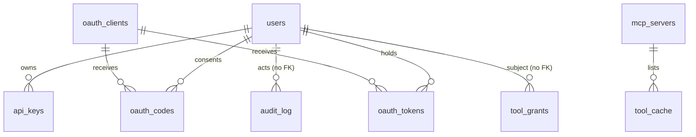

# Data model

Everything the platform stores, the type of each field, and why. The source of truth for the gateway tables is `apps/gateway/src/migrations.ts` (a test fails if `db/schema.ts` disagrees). The provisioner's tables are in `apps/provisioner/src/db.ts`. One Postgres 16 instance serves both; each service has its own migration table.

## Conventions and why

| Choice | Reason |
| --- | --- |
| Primary keys are `uuid` generated by the application (`crypto.randomUUID()`), except `audit_log.id` | A uuid can be shown in a URL or a log without revealing how many users or servers exist, and can be created before the insert (needed when a Secret and a row must agree). Audit rows are append-only and ordered, so a `bigserial` gives cheap, stable keyset paging. |
| All timestamps are `timestamptz` | The cluster, the browser and the store (WooCommerce) can sit in different time zones. `timestamptz` stores an instant; the UI formats it. |
| "Enums" are `text` with a `check` constraint, and a TypeScript union in `types.ts` | Adding a value to a Postgres enum is a migration with locking rules; a check constraint is replaced in one statement. Columns that the gateway itself writes (`outcome`, `role`, `status`) are not constrained in SQL because the application is the only writer and the union type is the contract; columns written by users or other services (`subject_type`, `effect`, `kind`, store `status`) carry a check. |
| Secrets are never stored in clear. API keys and OAuth tokens: SHA-256 of the token. Passwords: argon2id. Upstream credentials: AES-256-GCM | Different threats, different tools. Tokens are 256-bit random, so a fast hash is enough and lets the gateway look a key up by a prefix and compare in constant time. Passwords are low-entropy human input and need a slow, memory-hard hash. Upstream credentials must be recovered to be used, so they are encrypted, with a key kept outside the database. |
| Durations are `double precision` milliseconds | Sub-millisecond calls exist; an integer would record 0. |
| No `on delete cascade` from `users`, except on OAuth rows | Users are disabled, never deleted, so the audit log and API keys keep a meaning. OAuth rows are credentials, so they go with the user or client. |

## Gateway tables



### `users`
| Column | Type | Notes |
| --- | --- | --- |
| `id` | uuid pk | |
| `username` | text unique not null | login name; validated `^[A-Za-z0-9._-]{2,40}$` |
| `password_hash` | text not null | argon2id (`Bun.password`, 19 MiB, 2 passes) |
| `role` | text not null | `admin` or `member` (TypeScript `Role`) |
| `disabled_at` | timestamptz null | null means active. A disabled user cannot log in, and their keys and OAuth tokens stop working on the next request |
| `created_at` | timestamptz not null default now() | |

The last active admin cannot be disabled or demoted (`countActiveAdmins`, enforced in `routes/accounts.ts`).

### `api_keys`
| Column | Type | Notes |
| --- | --- | --- |
| `id` | uuid pk | |
| `user_id` | uuid fk users | |
| `prefix` | text not null | first 12 characters of the token (`umk_` plus 8), partial index `where revoked_at is null` finds the candidate row |
| `key_hash` | text not null | hex SHA-256 of the whole token |
| `label` | text not null | what the user called it |
| `created_at`, `revoked_at`, `last_used_at` | timestamptz | revoke sets `revoked_at`; the row stays for the audit trail |

Token format: `umk_` + base64url of 32 random bytes (256 bits). Shown once.

### `mcp_servers`
| Column | Type | Notes |
| --- | --- | --- |
| `id` | uuid pk | |
| `slug` | text unique not null | the public tool prefix; `^[a-z][a-z0-9]*(_[a-z0-9]+)*$`, 2-32 characters, never changed after creation because tool names and audit rows refer to it |
| `display_name` | text not null | |
| `url` | text not null | the upstream's Streamable HTTP endpoint; validated by the SSRF resolver on write and on every connection |
| `enabled` | boolean not null default true | disabled servers are not contacted and their tools disappear |
| `credential_type` | text not null default `none` | `none`, `bearer` or `header` |
| `credential_header_name` | text null | for `header`; forbidden names (`host`, `cookie`, `content-length`, ...) are refused |
| `credential_ciphertext` | text null | JSON `{iv, tag, ciphertext}` (base64) from AES-256-GCM under `CREDENTIAL_KEY`. Never returned by the API; the UI sees `credentialSet: boolean` |
| `managed_by` | text null | `store` or `hosted` when the provisioner owns the server; such a server cannot be edited or deleted by hand |
| `status` | text not null default `connected` | `connected`, `unreachable` (a disabled server is reported as `disabled`) |
| `status_detail` | text not null default `` | the classified reason, e.g. `connection refused: ...` (ADR 0020) |
| `last_checked_at` | timestamptz null | the probe lease: a replica that updates it past a staleness window owns the next probe |
| `created_at`, `updated_at` | timestamptz | |

### `tool_cache`
Primary key `(server_id, upstream_name)`, `server_id` references `mcp_servers` `on delete cascade`.
| Column | Type | Notes |
| --- | --- | --- |
| `description` | text not null | cleaned of control and bidi characters and capped at 1500 characters before storage (it goes into a model's context) |
| `input_schema` | jsonb not null | the upstream's JSON Schema, passed to clients unchanged |
| `annotations` | jsonb not null default `{}` | the subset of MCP annotations the gateway understands: `readOnlyHint`, `destructiveHint`, `title` |
| `fetched_at` | timestamptz | the cache lives 30 seconds; Postgres, not memory, so two replicas agree |

### `audit_log`
`id bigserial pk`. Columns and reasons are in ADR 0019: `at`, `user_id` (no FK: a rejected credential has no user), `api_key_id`, `actor` (`mcp` or `chat`), `server_slug`, `tool_name`, `duration_ms`, `outcome` (`success`, `error`, `timeout`, `unreachable`, `denied`, `unauthorized`), `error_code`, `trace_id`. Indexes: `(at desc)`, `(user_id, at desc)`, `(server_slug, at desc)`, `(outcome, at desc)`. Arguments and results are deliberately not stored.

### `tool_grants`
`unique (subject_type, subject, server_slug, tool_name)`; check constraints on `subject_type` (`role` or `user`) and `effect` (`allow` or `deny`). `subject` is a role name or a user id; there is no foreign key because a rule for a role is not a row in `users`. `tool_name` defaults to `*`. See ADR 0010 for the precedence rules.

### `throttle`
`key text pk, tokens double precision, updated_at timestamptz`. One token bucket per key, refilled at `limit / 60` tokens per second by a single `insert ... on conflict do update ... where` statement, so every replica sees the same bucket. Keys: `key:<apiKeyId>`, `oauth:<userId>`, `login:ip:<ip>`, `login:user:<name>`, `chat:<userId>`, `oauth-token:<ip>`, `oauth-register:<ip>`.

### OAuth tables (ADR 0012)
- `oauth_clients(client_id text pk, name, redirect_uris jsonb, kind 'dcr'|'cimd', created_at, updated_at)`. `client_id` is text because a metadata-document client's id is an https URL.
- `oauth_codes(code_hash pk, client_id fk, user_id fk, redirect_uri, code_challenge, resource, family_id uuid, expires_at, used_at)`. Ten minutes, single use; `used_at` is how a replay is detected.
- `oauth_tokens(id uuid pk, token_hash unique, kind 'access'|'refresh', family_id uuid, client_id fk, user_id fk, resource, expires_at, revoked_at, created_at, last_used_at)`. `family_id` ties the access and refresh tokens of one grant together, so revoking or detecting reuse is one `update ... where family_id`. `resource` is the audience the token was issued for (`<public base>/mcp`).

### `schema_migrations`
`(version int pk, name text, applied_at timestamptz)`; written in the same transaction as each migration.

## Provisioner tables

### `stores`
| Column | Type | Notes |
| --- | --- | --- |
| `id` | uuid pk | |
| `owner_id`, `owner_name` | uuid, text | the creating user; no FK because the provisioner does not own `users`. The name is copied so the list renders without a join |
| `name` | text | what the user typed |
| `slug` | text unique | `^[a-z][a-z0-9]{2,15}$`; becomes the namespace `store-<slug>`, the host `<slug>.<domain>` and the MCP slug `store_<slug>` |
| `namespace`, `host` | text unique / text | derived and stored so a later domain change does not orphan a store |
| `status` | text check | `provisioning`, `ready`, `failed`, `deleting` |
| `phase` | text | where the state machine is: `namespace`, `secrets`, `release`, `register` (provisioning); `unregister`, `uninstall`, `namespace`, `drain` (deleting); `done` |
| `reason` | text | the last error or the failure reason shown to the user |
| `attempt` | int | incremented by Retry |
| `deadline_at` | timestamptz | `created_at + PROVISION_TIMEOUT_SECONDS`; renewed by Retry |
| `lease_owner`, `lease_until` | text, timestamptz | the claim; a dead pod's lease expires and another worker resumes |
| `next_run_at` | timestamptz | backoff after a retryable error |
| `created_at`, `ready_at`, `updated_at` | timestamptz | `ready_at - created_at` is the provisioning time metric |
`unique (owner_id, name)` and the unique slug make create idempotent; the per-owner limit is checked under `pg_advisory_xact_lock(hashtext(owner_id))`.

### `hosted_servers`
Same state-machine columns, plus `slug` (the MCP slug), `display_name`, `image`, `size` (`small`, `medium`, `large`), `port`, `env jsonb` (plain variables), `secret_keys jsonb` (names only; values live in a Kubernetes Secret), `created_by`.

## Values that are not in a table

| Thing | Shape | Where |
| --- | --- | --- |
| Public tool name | `{slug}__{upstreamName}`; the first `__` separates, so neither part may contain `__` | `packages/mcp-names` |
| Session cookie `urumi_session` | `base64url(JSON {uid, role, exp}) + "." + base64url(HMAC-SHA256)`, httpOnly, SameSite=Lax, Secure when TLS is on, 12 hours | `crypto.ts` |
| OAuth tokens | `umo_`/`umr_`/`umc_` + 256 random bits | `oauth.ts` |
| Kubernetes Secrets per store | `store-db {password, root-password}`, `store-admin {username, password, email}`, `store-wc-api {consumer-key, consumer-secret}` | provisioner `secrets` phase |
| Namespace labels | `urumi.io/managed=true`, `urumi.io/store=<slug>`, Pod Security `enforce=baseline` | provisioner `namespace` phase |

## State machines

```
provisioning:  namespace -> secrets -> release -> register -> ready
                    \________________ any phase ______________/-> failed (deadline, helm error, foreign namespace)
failed:        --retry--> provisioning (attempt + 1)
any state:     --delete--> deleting
deleting:      unregister -> uninstall -> namespace -> drain -> (row removed)
```
