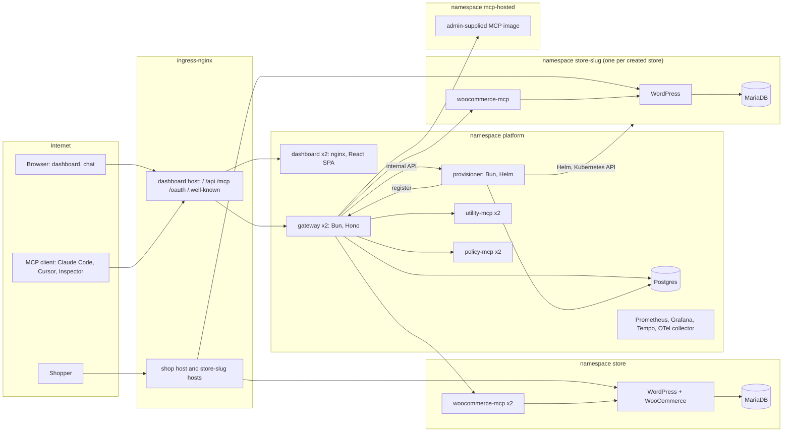

# System design and tradeoffs

The architecture as built. The reasons are in `docs/adr/`; the data is in [data-model.md](data-model.md); the request path is in [mcp-internals.md](mcp-internals.md); who can do what is in [threat-model.md](threat-model.md). Where this file says something ran on a cluster, the evidence is in [log.md](log.md) and `docs/evidence/`.

## Shape

Four layers from the brief, plus the bonus: **Store** (WordPress, WooCommerce, MariaDB, persistent volumes, cash on delivery), **WooCommerce MCP server** (ours, Streamable HTTP, REST to `wc/v3`, ClusterIP only), **Gateway and dashboard**, **Chat agent** (inside the gateway process, acts as the signed-in user), and the **provisioner** with the per-store and hosted-server charts.

Public: the dashboard host (`/`, `/api`, `/mcp`, `/oauth`, `/.well-known`), the shop host, and each store's host. Internal only: every MCP server, Postgres, the provisioner, metrics ports, the collector. Enforcement is the absence of an Ingress plus a NetworkPolicy per workload.

## Architecture choices and tradeoffs

| Choice | Why | Cost |
| --- | --- | --- |
| Bun and Hono, TypeScript, one workspace, one lockfile (ADR 0002) | one runtime and language for gateway, MCP servers and provisioner; the MCP SDK runs on Bun; small images | Bun is younger than Node; two Bun quirks surfaced and are recorded in `log.md` |
| Stateless Streamable HTTP, JSON responses, no sessions (ADR 0003) | any replica can serve any request; no affinity; a pod can be killed mid-conversation | no server-to-client messages (notifications, sampling); not needed by tools-only servers |
| `{slug}__{tool}` names, prefix stripped on the way in (ADR 0003) | removes collisions without changing upstream tools; a model can see which server a tool is on | a tool whose own name contains `__` is skipped |
| Official WordPress and MariaDB images, our templates, WP-CLI bootstrap Job (ADR 0004) | Bitnami's public images are no longer a safe dependency; the bootstrap is idempotent | more templates to own; images start as root |
| WooCommerce over REST, not WP-CLI exec, not the WooCommerce MCP plugin (ADR 0004) | documented API, least privilege, a server we wrote ourselves as the brief requires | WooCommerce keys cannot be scoped per user; the gateway is where users are told apart |
| One Helm chart, `values-local` and `values-prod` (ADR 0005) | the brief's "same charts, configuration changes only" | a few values differ in more than one file; values drift is checked by rendering both in CI |
| Hashed keys, encrypted upstream credentials, no token passthrough (ADR 0006) | different secrets, different protections; the brief's four threat-model questions | one shared upstream credential per server |
| Two replicas, shared rate limit, metrics, traces from the first deploy (ADR 0007) | proves the second replica is correct, not just present | heavier local cluster |
| Versioned migrations (ADR 0009) | schema changes on a live database; two replicas migrating at once | no down migrations |
| Grant table, most specific wins, read-only default (ADR 0010) | the brief's tool-permission example, enforced in the router | annotations are the upstream's claim |
| Resolve, pin, deny at the network (ADR 0011) | SSRF protection that survives a DNS race | https is not pinned; network policy carries it |
| Built-in OAuth 2.1 server (ADR 0012) | browser login for MCP clients, same permission path as keys | a consent page and three tables to own |
| Separate provisioner driving Helm from a database state machine (ADR 0013) | idempotent, resumable, parallel, no Kubernetes rights in the gateway | desired state is in Postgres, not a CRD |
| Namespace per store, quotas, default-deny policies (ADR 0014, 0015) | isolation and guardrails the brief lists | one WordPress and MariaDB per store, so a store costs about 400 MiB |
| Hosted MCP images in a restricted namespace (ADR 0016) | the stand-out item, with the blast radius bounded | no egress for hosted servers by default |
| Search surface for large catalogs (ADR 0017) | three tools instead of hundreds | two or three calls where one would do |

## Tool aggregation, routing and failure handling

1. `tools/list` fans out to every enabled upstream **in parallel**, each with a 3 second deadline, through a 30 second Postgres cache. A server that misses the deadline is left out and marked Unreachable with a reason; the rest are returned. The list is filtered by the caller's permissions.
2. `tools/call` splits `slug__tool`, loads the server, applies the rate limit, checks the tool exists, applies permissions, calls the upstream with an 8 second deadline through a warm client, and writes the audit row. Reads are retried once on a dropped connection; creates and status updates are never retried.
3. A disabled server is never contacted and vanishes from every surface. A dead one fails only its own calls, with `upstream_unreachable` or `upstream_timeout`.
4. Upstream credentials are decrypted in the gateway and written to one outbound header. Nothing the caller sent is forwarded.

Detail and the failure matrix: [mcp-internals.md](mcp-internals.md).

## What changes for production

DNS (dashboard, shop, wildcard for stores), ingress with cert-manager TLS, a registry and version-tagged images, a larger storage class and claims, higher limits, HPA max 4, two provisioner replicas, secrets generated on the node. The list of every value is in [vps-deploy.md](vps-deploy.md); the local domain approach (hosts file for two names, `*.localhost` for stores) is in the README.

## Scaling and observability

Gateway, dashboard and MCP servers run two replicas behind a Service with a PodDisruptionBudget, `maxUnavailable: 0` rolling updates and an HPA on CPU. State that must agree across replicas lives in Postgres: tool cache, server status, the probe lease, rate-limit buckets, audit. JSON logs carry a trace id; `/metrics` on port 9090 feeds Prometheus (`tool_calls_total`, `tool_call_duration_seconds`, `upstream_up`, `rate_limit_rejected_total`, provisioning gauges), Grafana ships a gateway dashboard, spans flow through the OTel collector to Tempo with W3C `traceparent` joining gateway, MCP server and WooCommerce spans. Alert rules are in the Prometheus config ([ADR 0020](adr/0020-alerts-and-failure-reasons.md)).

## Limits worth stating

One Postgres (no HA), one WordPress and MariaDB per store (no horizontal WordPress), the gateway's warm connections are per replica, the audit log has no retention job, alerts have no receiver, hosted servers have no egress, and https upstreams are not DNS-pinned. See [threat-model.md](threat-model.md) for the security view.
